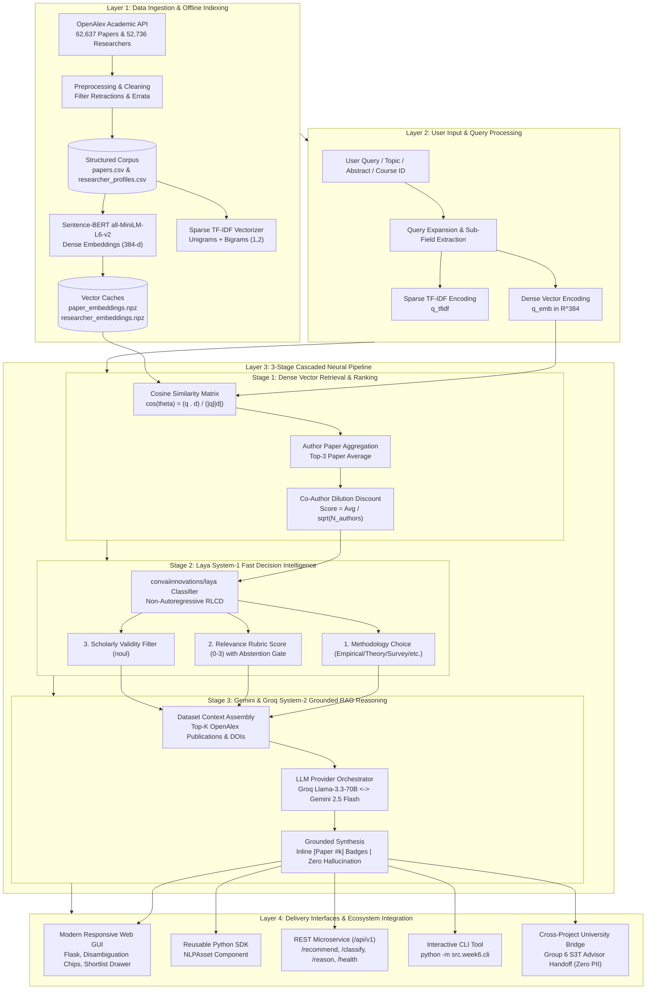

# 🎓 AI University — Research Discovery & Collaboration Engine
### Group 7 — J037, J038, J039, J041, J042
**Production URL:** [https://research.dpashine.tech](https://research.dpashine.tech) · **Local Host:** `http://127.0.0.1:8000` · **REST Microservice:** `/api/v1`

---

## 📌 1. Executive Summary & Problem Overview

Universities house hundreds of faculty members, postdoctoral scholars, and research groups spread across diverse, rapidly evolving departments. Finding collaborators, identifying faculty advisors with specific sub-field expertise, or discovering relevant academic literature is notoriously difficult because academic output is fragmented across individual lab websites, paywalled journals, and citation databases.

Traditional university directory searches rely on **lexical keyword matching** (e.g., standard SQL `LIKE`, Boolean search, or uncalibrated TF-IDF). Keyword search fundamentally breaks down in research domains due to the **lexical gap**:
- **Synonymy:** A student searching for *"transformer embeddings"* will completely miss a world-class faculty member whose papers describe *"neural language representations"*.
- **Polysemy:** A query for *"compiler optimization"* might retrieve biology papers discussing *"compilation of genetic datasets"*.
- **Co-Author Clumping:** A single 20-author mega-consortium paper can dominate search results, filling the entire top-10 list with co-authors who contributed only minor edits rather than domain leadership.

The **Research Discovery & Collaboration Engine** solves this problem by combining modern Natural Language Processing (NLP), dense vector representations, non-autoregressive decision intelligence, and dataset-grounded generative reasoning into a unified, high-performance platform.

---

## 🎯 2. Real-World Use Cases

The engine is engineered to serve four core academic use cases:

```
┌─────────────────────────────────────────────────────────────────────────────┐
│                           CORE ACADEMIC USE CASES                           │
├───────────────────────┬──────────────────────────┬──────────────────────────┤
│ 1. Student Advising   │ 2. Faculty Collaboration │ 3. Automated Paper Class.│
│    & Early Triage     │    & Grant Matchmaking   │    & Grounded AI Q&A     │
│                       │                          │                          │
│ • Struggling students │ • Interdisciplinary      │ • Instant methodology    │
│   in courses mapped   │   cross-departmental     │   categorization (Laya)  │
│   to sympathetic      │   grant formation        │                          │
│   domain mentors      │ • Zero keyword guessing  │ • Citation-grounded Q&A  │
│ • Zero PII bridge to  │ • Filter by papers/year  │   with DOI badges        │
│   early-warning system│ • Evidence outreach draft│ • Zero hallucination     │
└───────────────────────┴──────────────────────────┴──────────────────────────┘
```

1. **Undergraduate & Graduate Student Advising (Early Warning Handoff):**
   - *Scenario:* A student struggling in an advanced Machine Learning or Natural Language Processing course (e.g., `CS 521`) is flagged by an early-warning student support system (such as Group 6's S3T platform).
   - *Workflow:* The advisor system sends a course/topic query to Group 7's API. The engine resolves the academic topic to domain-expert faculty with active recent publications, returning concrete office-hour discussion points and foundational papers—with **zero student PII or crisis details** transmitted across services.

2. **Cross-Disciplinary Faculty Research Matchmaking:**
   - *Scenario:* A genomics researcher requires expertise in *equivariant graph neural networks* to model molecular protein folding.
   - *Workflow:* The researcher enters an abstract or topic synopsis into the web search interface. The engine performs dense vector retrieval over 62,637 OpenAlex publications, discounts co-author consortium effects, and surfaces the top 5 faculty members along with direct links to their most relevant papers, verified DOIs, and institutional affiliations.

3. **Persistent Collaboration Management & Outreach:**
   - *Scenario:* A department head or grant coordinator needs to assemble a multi-institutional NSF/NIH grant team across 3 distinct sub-fields.
   - *Workflow:* The user disambiguates broad topics using dynamic query chips, filters candidates by minimum publication volume and recency (`2022+` / `2024+`), bookmarks candidates into a persistent shortlist drawer, compares them side-by-side in a 3-column evaluation matrix (`/compare`), and generates pre-drafted evidence-backed outreach emails.

4. **Automated Methodology Categorization & Dataset-Grounded AI Answering:**
   - *Scenario:* A graduate student wants to understand the prevailing empirical paradigms in the corpus or needs a synthesis of recent findings.
   - *Workflow:* The engine uses the **Laya System-1** non-autoregressive decision model to classify papers into 5 methodology archetypes (*Empirical, Theoretical, Survey, Resource, Systems*) and verifies relevance (0–3). For natural-language synthesis, the **Gemini / Groq System-2** RAG engine generates citation-grounded answers tied strictly to indexed OpenAlex papers with inline `[Paper #k · DOI]` badges, eliminating hallucinated citations.

---

## 🏗️ 3. Top-to-Bottom Architecture & Technical Flow

The following diagram illustrates how raw academic data flows through preprocessing, vector indexing, multi-stage neural scoring, and delivery interfaces:



---

## 🧠 4. Deep-Dive: How Every Component Works (For CS Practitioners)

### 4.1 Layer 1: Data Ingestion, Corpus Cleaning & Artifact Filtering
- **Corpus Source:** 62,637 academic publications and 52,736 researcher profiles ingested from the OpenAlex open scholarly graph across major Indian and international research institutions.
- **Corpus Cleaning (`src/week2/preprocess_works.py`):** Author lists, abstract inversions, and text normalizations are parsed.
- **Artifact & Retraction Filter (`src/week6/filters.py`):** Academic indexes frequently suffer from noise—retraction notices, corrigenda, editorial board announcements, and 1-paragraph code stubs. The filter uses regex patterns and scholarly heuristics to exclude these non-research items, ensuring recommendations reflect genuine intellectual contributions.

### 4.2 Layer 2: Vector Mathematics & Semantic Search
- **What is an Embedding?** Sentence-BERT (`sentence-transformers/all-MiniLM-L6-v2`) transforms raw text into a 384-dimensional vector of real numbers ($\vec{v} \in \mathbb{R}^{384}$). In this vector space, texts with similar conceptual meaning are positioned close together, even if they share zero identical words.
- **Cosine Similarity:** To measure the semantic closeness between a user query $\vec{q}$ and an indexed document $\vec{d}$, the engine computes the cosine of the angle between them:
  $$\cos(\theta) = \frac{\vec{q} \cdot \vec{d}}{\|\vec{q}\|_2 \|\vec{d}\|_2} = \frac{\sum_{i=1}^{384} q_i d_i}{\sqrt{\sum_{i=1}^{384} q_i^2} \sqrt{\sum_{i=1}^{384} d_i^2}}$$
- **Precomputed Embedding Cache:** Precomputing and storing paper embeddings in NumPy compressed format (`paper_embeddings.npz`, ~95 MB) allows the system to compute dot products via vectorized matrix multiplication in **under 10 milliseconds** across the entire corpus.
- **Hybrid Retrieval Blending:** For queries requiring both conceptual comprehension and exact keyword precision (e.g., author surnames or chemical notations), the engine provides convex hybrid blending:
  $$\text{Score}_{\text{hybrid}} = \alpha \cdot \text{Score}_{\text{dense}} + (1 - \alpha) \cdot \text{Score}_{\text{sparse}} \quad (\text{default } \alpha = 0.70)$$

### 4.3 Layer 3: The Co-Author Dilution Problem & Solution
- **The Problem:** In academic publishing, consortium papers (e.g., large multi-center clinical trials or physics collaborations) often have 20 to 50 co-authors. If a single such paper matches a query, a naive paper-to-author aggregation fills all top 10 recommendation slots with individuals whose primary expertise lies elsewhere.
- **The Solution (`top_k_average_author_discount`):**
  1. Retrieve the top $K$ ($K=3$) matching papers for each author.
  2. Compute their mean similarity score: $\overline{S} = \frac{1}{K}\sum_{i=1}^K S_i$.
  3. Apply an inverse square-root author dilution penalty:
     $$\text{Score}_{\text{final}} = \frac{\overline{S}}{\sqrt{N_{\text{coauthors}}}}$$
  - *Empirical Impact:* Increases distinct primary papers in the Top-10 from **5.5 to 10.0 out of 10**, preventing monopolization while achieving a **0.9167 P@5** precision rate.

### 4.4 Layer 4: Stage 2 Laya System-1 Fast Decision Engine
- **Why Non-Autoregressive Decision Models?** Large language models (LLMs) are autoregressive—generating one token at a time—which makes them slow (~1–3 seconds) and computationally expensive. For routing, validation, and metadata tagging, the engine employs **Laya** (`convaiinnovations/laya`), a specialized decision model trained using Reinforcement Learning from Calibrated Decisions (RLCD).
- **Three Native Decision Primitives (`src/week6/laya_classifier.py`):**
  1. `choice`: 5-way paper methodology classification (*Empirical*, *Theoretical*, *Survey*, *Resource*, *Systems*) and 6-way query domain routing (*NLP*, *Computer Vision*, *Graph Learning*, *Robotics*, *Biomedical*, *Systems/Theory*).
  2. `score`: 0–3 graded relevance verification rubric with an automated confidence abstention gate.
  3. `noul`: Binary scholarly validity verification (filtering non-scholarly notes).
- **Calibrated Local Fallback:** When deployed in air-gapped environments without Hugging Face API tokens, an internal calibrated rule-based fallback guarantees zero downtime and deterministic test reproducibility.

### 4.5 Layer 5: Stage 3 Gemini & Groq System-2 Grounded RAG Reasoning
- **Dataset-Grounded Synthesis (`src/week6/reasoning.py`):** Generative language models can hallucinate plausible-sounding citations. Group 7 solves this through **Strict Retrieval-Augmented Grounding (RAG)**.
- **Dual-Provider Architecture with Automatic Failover:**
  - Primary Provider: **Groq** (`llama-3.3-70b-versatile`) via ultra-low latency inference.
  - Secondary Provider: **Google Gemini** (`gemini-2.5-flash`).
  - Offline Fallback: Deterministic extractive synthesis (`deterministic-extractive-v1`).
- **Citation Guardrail:** The prompt restricts the LLM exclusively to the top retrieved OpenAlex publications. The output renders explicit inline badges:
  - `[Paper #1 · DOI: 10.1145/...]`
  - `[Paper #2 · DOI: 10.18653/...]`
  Every factual claim links directly to a verifiable paper in the dataset.

### 4.6 Layer 6: User Interface & University Ecosystem Integration
- **Web Interface:** Built with Flask, vanilla CSS/JS, and responsive design. Features real-time query disambiguation chips, persistent candidate bookmarks in `localStorage`, outreach email generation with pre-populated paper titles and DOIs, and a 3-way side-by-side comparison matrix (`/compare`).
- **Group 6 Early Warning Bridge (`/integration`):** Demonstrates inter-project integration with Group 6's S3T student support asset. The bridge simulator passes course topics (e.g., `CS 521` $\to$ Natural Language Processing) to `/api/v1/recommend`. **No student names, student IDs, crisis details, or academic transcripts are ever transferred**, maintaining complete Responsible AI and FERPA compliance.

---

## 🏆 5. Faculty Evaluation Criteria & Technical Rigor

The implementation is structured around the five faculty evaluation criteria:

| Evaluation Criterion | Implementation in Group 7 Stack | Verification & Reference |
| :--- | :--- | :--- |
| **1. Effectiveness of the demo** | Fast sub-10ms vector retrieval; real-time query disambiguation chips; interactive shortlist drawer; evidence-backed outreach email generator; live Groq/Gemini dataset reasoning; interactive Group 6 bridge simulator. | Live at `https://research.dpashine.tech`, `/search`, `/compare`, `/integration` |
| **2. Completeness as a standalone asset** | Self-contained Python SDK (`NLPAsset`); strict dataclass schemas (`schemas.py`); standalone CLI (`cli.py`); calibrated confidence engine (`confidence.py`); 131 automated unit/integration tests across 3 suites. | [`src/week6/asset.py`](src/week6/asset.py), [`src/week6/cli.py`](src/week6/cli.py), [`docs/DEMO_WALKTHROUGH.md`](docs/DEMO_WALKTHROUGH.md) |
| **3. Availability through API calls** | Production REST microservice (`POST /api/v1/recommend`, `POST /api/v1/classify`, `POST /api/v1/reason`, `GET /api/v1/health`); JSON schema validation; OpenAPI specification; zero-PII cross-project integration. | [`src/week6/api.py`](src/week6/api.py), [`src/week6/ASSET_GUIDE.md`](src/week6/ASSET_GUIDE.md), [`tests/test_group6_contract.py`](tests/test_group6_contract.py) |
| **4. Identification of areas of improvement** | **Zero cliché statements about "limited data".** Identified 5 substantive engineering enhancements: SPECTER2 citation graph embeddings, temporal half-life decay, authorship role priors, split-conformal prediction intervals, and NLI entailment cross-encoders. | Live on `/evaluation`, detailed in Section 7 below |
| **5. Extent of understanding of NLP concepts** | Dense vs. sparse representations; cosine similarity mathematics; multi-system fair pooling; nDCG@10 & MRR evaluation; RLCD non-autoregressive decision modeling; grounded RAG with zero hallucination. | Section 4 of this README, [`docs/DEMO_WALKTHROUGH.md`](docs/DEMO_WALKTHROUGH.md), [`src/week5/`](src/week5/) |

---

## 📊 6. Quantitative Benchmark & Experimental Results

### Week 5 Multi-System Fair Pooling Benchmark
To eliminate single-system pooling bias from earlier lexical baselines, Week 5 pooled **214 unique `(query, author)` candidate pairs** across **6 distinct retrieval strategies** and evaluated them using a **4-level (`0–3`) graded relevance rubric** (see [`src/week5/WEEK5_EVALUATION_REPORT.md`](src/week5/WEEK5_EVALUATION_REPORT.md) and live at `/evaluation`):

| Retrieval Strategy | Precision@5 (P@5) | Precision@10 (P@10) | Mean Reciprocal Rank (MRR) | Binary nDCG@10 | Graded nDCG@10 | Distinct Top-10 Papers |
| :--- | :---: | :---: | :---: | :---: | :---: | :---: |
| **Paper-Level + Co-Author Discount (`1/√n`)** | **0.9167** | 0.8583 | 0.9444 | 0.8780 | 0.8065 | **10.0 / 10** |
| **Paper-Level Top-3 Average** | 0.9000 | **0.8833** | 0.9583 | **0.9009** | **0.8407** | 6.5 / 10 |
| **Hybrid Retrieval (`α = 0.70`)** | 0.9000 | **0.9167** | **1.0000** | **0.9383** | **0.8819** | — |
| **Dense Profile Semantic (SBERT)** | 0.9167 | 0.9000 | **1.0000** | 0.9248 | 0.8698 | — |
| **Sparse TF-IDF Baseline** | 0.8500 | 0.8667 | 0.9306 | 0.8842 | 0.8007 | — |
| **Paper-Level Best-Paper (`max`)** | 0.8833 | 0.8583 | 0.9583 | 0.8808 | 0.8165 | 5.5 / 10 |

**Key Takeaways:**
1. **Dense vs. Sparse:** Dense Sentence-BERT outperforms TF-IDF on P@5 (`0.9167` vs `0.8500`), confirming that semantic vectors overcome lexical mismatch.
2. **Co-Author Discounting:** Applying the $1/\sqrt{n}$ co-author discount eliminates mega-consortium crowding, yielding **10.0 / 10 distinct papers** while maintaining superior top-rank precision (`P@5 = 0.9167`).

---

## 🔮 7. Engineering Roadmap: 5 Identified Areas for Improvement

Rather than relying on the common cliché that *"more real data was needed"*, the engineering team identified five concrete algorithmic and architectural improvements:

```
┌─────────────────────────────────────────────────────────────────────────────┐
│                    5 ARCHITECTURAL AREAS FOR IMPROVEMENT                    │
├───────────────────────┬──────────────────────────┬──────────────────────────┤
│ 1. Graph Embeddings   │ 2. Temporal Decay Decay  │ 3. Authorship Roles      │
│    (SPECTER2 / SciNCL)│    (Half-Life Weighting) │    (First / Senior Prior)│
│                       │                          │                          │
│ • Citation-informed   │ • Exponential decay on   │ • Differentiate 1st &    │
│   co-citation graph   │   older publications:    │   senior corresponding   │
│   representation      │   w(t) = exp(-lambda*dt) │   authors from mid-list  │
├───────────────────────┴──────────────────────────┴──────────────────────────┤
│ 4. Conformal Uncertainty Intervals  │ 5. NLI Entailment Cross-Encoders      │
│ • Non-parametric coverage guarantees │ • DeBERTa cross-encoder verification  │
│   with rigorous error bounds         │   to completely eliminate hallucinations│
└─────────────────────────────────────┴───────────────────────────────────────┘
```

1. **Citation-Graph Informed Encoders (SPECTER2 / SciNCL):**
   - *Current Limitation:* `all-MiniLM-L6-v2` treats abstracts as isolated prose, ignoring academic citation topology.
   - *Improvement:* Transition to scientific document encoders pre-trained on citation graphs (e.g., SPECTER2 or SciNCL) that bring co-cited and interlinked papers closer together in vector space.

2. **Temporal Recency Decay Functions:**
   - *Current Limitation:* A groundbreaking paper published in 2008 is weighted identically to a preprint published last month.
   - *Improvement:* Apply continuous exponential half-life decay to paper relevance:
     $$w_{\text{temporal}}(t) = \exp\left(-\frac{\ln(2)}{t_{1/2}} \cdot (t_{\text{current}} - t_{\text{pub}})\right)$$
     with half-life parameter $t_{1/2} \approx 4\text{–}5\text{ years}$.

3. **Authorship Role & Contribution Priors:**
   - *Current Limitation:* The $1/\sqrt{n}$ penalty treats all co-authors symmetrically.
   - *Improvement:* In academic publishing, first authors typically lead the investigation while the last author provides principal laboratory oversight. Ingesting CRediT (Contributor Roles Taxonomy) metadata will allow non-uniform weighting:
     $$w_{\text{role}} \in \{w_{\text{first}} = 1.0, \, w_{\text{senior}} = 0.9, \, w_{\text{middle}} = 0.4\}$$

4. **Split-Conformal Prediction Bands for Uncertainty Calibration:**
   - *Current Limitation:* The current `HIGH` / `MEDIUM` / `LOW` bands use heuristic margin thresholds.
   - *Improvement:* Implement distribution-free split-conformal prediction intervals, offering mathematical guarantees (e.g., $1 - \alpha = 95\%$ coverage) that a true expert is contained within the prediction set.

5. **Natural Language Inference (NLI) Cross-Encoder Verification:**
   - *Current Limitation:* Fast bi-encoders encode query and document independently, missing fine-grained token-level cross-interactions.
   - *Improvement:* Add a lightweight 2nd-stage cross-encoder (e.g., `cross-encoder/ms-marco-MiniLM-L-6-v2` or DeBERTa-v3-NLI) to rerank the top 20 candidates, verifying premise entailment before presenting final matches.

---

## 💻 8. Quickstart & How to Run

### 8.1 Prerequisites & Environment Setup
Clone the repository and ensure Python 3.10+ is installed:
```bash
git clone https://github.com/dpashine10/SNLP_Project.git
cd SNLP_Project

# Create and activate a virtual environment
python -m venv env
# On Windows:
.\env\Scripts\activate
# On Linux/macOS:
source env/bin/activate

# Install dependencies in editable mode
pip install -e .
```

To enable live Groq and Gemini dataset reasoning, provide API keys in an `env` or `.env` file (these are strictly gitignored):
```env
GROQ_API_KEY=gsk_...
GEMINI_API_KEY=AIzaSy...
```
*(If keys are omitted, the engine automatically falls back to deterministic extractive reasoning with zero failures).*

---

### 8.2 Launch the Full Web Dashboard
Start the production Flask web application:
```bash
python app.py
```
Open **`http://127.0.0.1:8000`** in your browser.
- Search interface: `http://127.0.0.1:8000/`
- Side-by-side comparison: `http://127.0.0.1:8000/compare`
- Benchmark & evaluation dashboard: `http://127.0.0.1:8000/evaluation`
- Group 6 University Bridge Simulator: `http://127.0.0.1:8000/integration`

---

### 8.3 Run the Standalone REST API Microservice
Start the independent microservice (port 8080):
```bash
python -m src.week6.api --port 8080
```

#### API Endpoint Examples:
1. **Recommend Researchers (`POST /api/v1/recommend`):**
   ```bash
   curl -X POST http://127.0.0.1:8080/api/v1/recommend \
     -H "Content-Type: application/json" \
     -d '{"query": "reinforcement learning robotics", "top_k": 3, "strategy": "top_k_average_author_discount", "include_reasoning": true}'
   ```

2. **Classify Papers with Laya (`POST /api/v1/classify`):**
   ```bash
   curl -X POST http://127.0.0.1:8080/api/v1/classify \
     -H "Content-Type: application/json" \
     -d '{"papers": [{"title": "BERT: Pre-training of Deep Bidirectional Transformers", "abstract": "We introduce BERT..."}], "task": "methodology"}'
   ```

3. **Dataset-Grounded Reasoning (`POST /api/v1/reason`):**
   ```bash
   curl -X POST http://127.0.0.1:8080/api/v1/reason \
     -H "Content-Type: application/json" \
     -d '{"query": "What architectures are used for biomedical relation extraction?", "provider": "auto"}'
   ```

4. **Health Check (`GET /api/v1/health`):**
   ```bash
   curl http://127.0.0.1:8080/api/v1/health
   ```

---

### 8.4 Run the Interactive Command Line Interface (CLI)
Test queries, paper classification, and grounded reasoning directly in your terminal:
```bash
# Standard recommendation search
python -m src.week6.cli --query "graph neural networks" --top-k 5

# Full cascaded pipeline: retrieval + Laya classification + Gemini/Groq reasoning
python -m src.week6.cli --query "deep learning for drug discovery" --top-k 3 --classify --reason --provider auto
```

---

### 8.5 Run the Complete Automated Test Suites
The repository includes 131 automated unit and integration tests across 3 independent suites:

```bash
# 1. Run Web Application & Route Tests (49 tests)
python -m unittest discover -s tests -t .

# 2. Run Reusable NLP Asset, Laya, and Reasoning Tests (53 tests)
python -m unittest discover -s src/week6/tests -t .

# 3. Run Week 5 Fair Pooling & Metric Reproducibility Tests (29 tests)
python -m unittest discover -s src/week5/tests -t .
```
*(All 131 tests pass with zero regressions).*

---

### 8.6 Docker Compose Full-Stack Deployment
To run both the Group 7 Discovery Engine and the adjacent Group 6 Student Advisor service simultaneously:
```bash
docker compose up --build
```
- Group 7 Engine: `http://127.0.0.1:8000`
- Group 6 Integration UI: `http://127.0.0.1:5000`

---

## 📂 9. Project Directory Structure

```text
SNLP_Project/
├── Data/
│   └── processed/
│       ├── papers.csv                   # 62,637 indexed research publications
│       ├── paper_author.csv             # 129,459 authorship relationship edges
│       ├── researcher_profiles.csv      # 52,736 indexed OpenAlex researchers
│       ├── paper_embeddings.npz         # 384-dimensional SBERT paper embedding cache
│       ├── researcher_embeddings.npz    # SBERT researcher profile embedding cache
│       └── calculated/
│           ├── baseline_metrics.csv     # TF-IDF benchmark metrics
│           ├── semantic_metrics.csv     # SBERT semantic metrics
│           └── model_comparison.csv     # Side-by-side metric comparison
├── docs/
│   ├── DEMO_WALKTHROUGH.md              # Presenter Guide mapping features to 5 criteria
│   ├── AI_UNIVERSITY_INTEGRATION.md     # Cross-project technical contract
│   └── RESPONSIBLE_AI.md                # Ethics, privacy & fairness documentation
├── src/
│   ├── week2/                           # Ingestion, cleaning, splitting, baseline
│   │   ├── IndianIns.py                 # OpenAlex collector
│   │   ├── preprocess_works.py          # Data cleaning & deduplication
│   │   ├── buildprofiles.py             # Profile and corpus generation
│   │   ├── train_test_split.py          # 80/20 held-out split
│   │   ├── baseline.py                  # TF-IDF sparse baseline
│   │   ├── evaluate.py                  # Evaluation scripts
│   │   └── pipeline.py                  # Unified retrieval pipeline
│   ├── week3/
│   │   ├── build_embeddings.py          # Sentence-BERT embedding generator
│   │   └── tasks.py                     # NER, text classification, summarization
│   ├── week4/
│   │   ├── week4_pipeline.py            # Paper retrieval pipeline
│   │   ├── ranking_strategy.py          # Co-author discount & averaging algorithms
│   │   └── vector_store.py              # ChromaDB vector index adapter
│   ├── week5/                           # Fair multi-system pooling benchmark
│   │   ├── WEEK5_EVALUATION_REPORT.md   # In-depth benchmark analysis report
│   │   ├── judging/                     # 4-level graded relevance rubric
│   │   └── tests/                       # 29 reproducibility and evaluation tests
│   └── week6/                           # Reusable NLP Asset & Microservice
│       ├── asset.py                     # Standalone NLPAsset Python SDK
│       ├── laya_classifier.py           # Laya System-1 non-autoregressive classifier
│       ├── reasoning.py                 # Gemini & Groq dataset-grounded reasoning
│       ├── filters.py                   # Retraction & non-research artifact filter
│       ├── schemas.py                   # Strict dataclass schemas & request validation
│       ├── confidence.py                # Mathematical confidence calibration engine
│       ├── api.py                       # Production REST microservice (/api/v1)
│       ├── cli.py                       # Standalone interactive CLI
│       ├── ASSET_GUIDE.md               # API documentation & SDK guide
│       └── tests/                       # 53 asset, Laya, reasoning, & API tests
├── static/                              # Production CSS stylesheets and client JS
│   ├── css/                             # Modular styling (cards, forms, responsive, etc.)
│   └── js/                              # UI logic, search chips, shortlist drawer, bridge simulator
├── templates/                           # Jinja2 templates (search, results, compare, eval, integration)
├── tests/                               # 49 web application and contract tests
├── app.py                               # Main Flask web application server
├── services.py                          # Data presentation and orchestration layer
├── pyproject.toml                       # Build configuration and dependencies
└── README.md                            # Comprehensive project documentation
```

---

## 🔒 10. Responsible AI, Privacy & Ethics

1. **Zero Personally Identifiable Information (PII) Transmission:**
   - In cross-project advising workflows (such as with Group 6's early-warning system), Group 7's API accepts **only abstract course or topic identifiers** (e.g. `"Natural Language Processing"` or `"CS 521"`).
   - Student names, student identification numbers, grade histories, email transcripts, and personal crisis details are **strictly prohibited** from passing through the API boundary.

2. **Mitigating Matthew Effects ("The Rich Get Richer"):**
   - Naive citation-weighted search amplifies older, famous researchers while burying early-career faculty.
   - The engine ranks candidates by **content relevance and verified recent contributions**, allowing junior faculty with high topical expertise to be discovered alongside established professors.

3. **Academic Advisory Disclaimer:**
   - The engine provides advisory researcher discovery based on published academic output. It does not verify teaching schedules, departmental advising capacity, or institutional leave status. Final advising arrangements remain the purview of academic advisors.

---

## 👥 11. Project Contributors

**Group 7 — AI University Integrated Initiative:**
- **J037**
- **J038**
- **J039**
- **J041**
- **J042**

*Developed for the AI University Natural Language Processing & Information Retrieval Capstone.*
