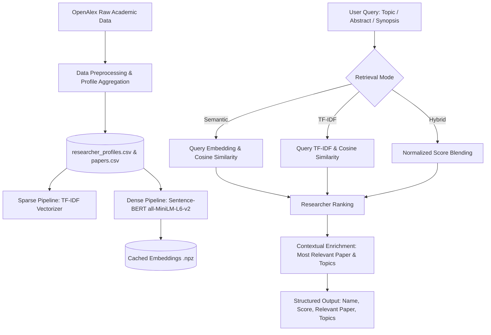

# 🎓 Research Discovery & Collaboration Engine
### AI University — Week 7 integrated prototype
**Group 7 — J037, J038, J039, J041, J042**

---

## 📌 1. Project Overview & Motivation

Universities house faculty and researchers working across diverse and rapidly evolving disciplines. Finding collaborators or identifying faculty with specific expertise is challenging because academic publications are scattered across disparate databases and personal profiles.

Traditional keyword search systems (e.g., standard Boolean or TF-IDF search) fail when researchers describe related work using different terminology (e.g., *"neural language representation"* vs. *"transformer embeddings"*). 

The **Research Discovery & Collaboration Engine** uses modern Natural Language Processing (NLP) techniques to bridge lexical gaps and map research descriptions, abstracts, and synopses to publication-based researcher matches. The current prototype does not verify teaching assignments, faculty status, or mentor availability.

---

## 🚀 2. Current deliverable: Week 7 integrated University prototype

The current deliverable combines the earlier retrieval pipeline with the Week 6 reusable API and the Group 6 student-support bridge. It includes:

1. **Primary NLP Component — Dense Semantic Embeddings:**
   - Powered by [Sentence-BERT (SBERT)](https://arxiv.org/abs/1908.10084) using the `all-MiniLM-L6-v2` architecture.
   - Produces dense 384-dimensional contextual sentence embeddings that encode deep semantic relationships beyond surface keywords.
   - Aggregates paper-level embeddings to build unified researcher expertise vectors.

2. **Baseline Model — Traditional Sparse TF-IDF:**
   - Features unigrams and bigrams (`ngram_range=(1, 2)`), sublinear TF scaling, and English stop-word filtering over academic profiles.
   - Serves as the traditional information retrieval benchmark.

3. **Hybrid Retrieval (Dense Semantic + Sparse Keyword):**
   - Weighted convex combination:
     $$\text{Score}_{\text{hybrid}} = \alpha \cdot \text{Score}_{\text{dense}} + (1 - \alpha) \cdot \text{Score}_{\text{sparse}}$$
   - Delivers the best of both worlds: handles novel vocabulary and synonyms while maintaining exact matches for specific terminology and author names.

4. **Contextual Paper & Topic Attribution:**
   - Rather than returning only researcher names, the pipeline extracts:
     - **Similarity Score:** Overall affinity index.
     - **Most Relevant Paper:** Title, year, and paper-level similarity score identifying *why* the researcher was matched.
      - **Related publication topics:** Topic labels extracted from supporting publications where available.

5. **High-Performance Vector Caching:**
   - Precomputes and caches paper and author embeddings (`paper_embeddings.npz` and `researcher_embeddings.npz`).
   - Query latency is **under 10 milliseconds** across nearly 10,000 researcher profiles.

6. **Additional Week 3 Baselines:**
   - Academic entity extraction for organizations, people, DOIs, URLs, email addresses, and years.
   - TF-IDF plus logistic-regression text classification.
   - Extractive TF-IDF summarization.
   - Sparse RAG document retrieval over the generated corpus.
   - Structured keyword and metadata extraction.

---

## 🏗️ 3. Architecture & Data Flow



---

## 📊 4. Benchmark & Quantitative Evaluation

The pipeline was evaluated on the curated benchmark dataset (`Data/processed/calculated/evaluation_candidates_labeled.csv`) across standard queries:
- `natural language processing`
- `machine learning`
- `transformer based text classification`
- `information retrieval`
- `knowledge graphs`
- `battery materials and energy storage`
- `quantum computing`
- `deep learning neural networks`

### Evaluation Metrics

| Retrieval Model | Precision@5 | Precision@10 | Mean Reciprocal Rank (MRR) | Relevant@10 |
| :--- | :---: | :---: | :---: | :---: |
| **TF-IDF Baseline** | 0.9600 | 0.9600 | 0.9000 | 9.6 |
| **Sentence Transformers (`all-MiniLM-L6-v2`)** | **1.0000** | **1.0000** | **1.0000** | **10.0** |
| **Hybrid (Semantic + TF-IDF)** | **1.0000** | **1.0000** | **1.0000** | **10.0** |

### 🔍 Key Finding: The Vocabulary Mismatch Problem
On broad queries (e.g., *"natural language processing"*), both TF-IDF and SBERT perform well because direct lexical matches abound. However, on descriptive or complex queries such as:
> **Query:** *"transformer based text classification"*

- **TF-IDF Baseline:** Ranked an author with superficial keyword overlap at **Rank 1** (`relevant = 0`), giving a **Reciprocal Rank of 0.50** (first relevant paper at rank 2).
- **Sentence Transformers:** Understands semantic intent and prioritizes authors of foundational transformer architectures and text classification work, placing true relevant authors at **Rank 1** and achieving **Reciprocal Rank of 1.00 (+0.50 gain)** and **Precision@5 of 1.00 (+0.20 gain)**.

---

## 📂 5. Project Structure

```text
SNLP_Project/
├── Data/
│   └── processed/
│       ├── papers.csv                   # 62,637 indexed research publications
│       ├── paper_author.csv             # 129,459 authorship relations
│       ├── researcher_profiles.csv      # 52,736 indexed OpenAlex researchers
│       ├── paper_embeddings.npz         # Precomputed paper embeddings
│       ├── researcher_embeddings.npz    # Precomputed author embeddings
│       └── calculated/
│           ├── baseline_metrics.csv     # TF-IDF evaluation scores
│           ├── semantic_metrics.csv     # Sentence-BERT evaluation scores
│           ├── model_comparison.csv     # Comparative benchmark summary
│           └── evaluation_candidates_labeled.csv # Ground-truth benchmark
├── src/
│   ├── week2/                            # Collection, cleaning, preprocessing, splits, and baseline
│   │   ├── IndianIns.py                  # OpenAlex collection (requires OPENALEX_API_KEY)
│   │   ├── preprocess_works.py           # Deduplication and cleaning
│   │   ├── buildprofiles.py              # Profile, paper, and RAG corpus construction
│   │   ├── train_test_split.py           # 80/20 held-out split
│   │   ├── baseline.py                   # TF-IDF baseline search
│   │   ├── create_evaluation_set.py      # Candidate annotation and baseline metrics
│   │   ├── evaluate.py                   # Baseline, semantic, and hybrid evaluation
│   │   └── pipeline.py                   # Retrieval pipeline
│   ├── week3/
│   │   ├── build_embeddings.py           # Sentence-BERT embedding builder and cacher
│   │   └── tasks.py                      # NER, classification, summarization, RAG, and extraction baselines
│   ├── week4/                            # Paper-level vector search & ChromaDB architecture
│   │   ├── week4_pipeline.py             # Paper retrieval and author aggregation pipeline
│   │   ├── ranking_strategy.py           # best_paper, average, top_k_average, author_discount
│   │   └── vector_store.py               # ChromaDB persistent vector index adapter
│   ├── week5/                            # Fair evaluation, graded judging, and error analysis
│   │   ├── WEEK5_EVALUATION_REPORT.md    # Comprehensive evaluation and error analysis report
│   │   ├── judging/                      # 4-level graded relevance rubric & candidate pool
│   │   └── evaluation/                   # Frozen runs, fair metrics, reproducibility checks
│   └── week6/                            # Deliverable: Reusable NLP Asset & Microservice
│       ├── asset.py                      # NLPAsset Python SDK component
│       ├── schemas.py                    # Strict input/output contracts and validation
│       ├── confidence.py                 # Ranking-confidence bands and explanations
│       ├── api.py                        # Flask REST API microservice (/api/v1)
│       ├── cli.py                        # Standalone interactive CLI
│       ├── README.md & ASSET_GUIDE.md    # Integration documentation & OpenAPI spec
│       └── tests/                        # 31 unit and integration tests
├── app.py                               # Web application (Flask routes)
├── services.py                          # Data preparation for the web pages (no HTML)
├── templates/                           # Jinja2 HTML templates
├── static/                              # CSS, JavaScript and images
├── tests/                               # Web application tests
├── pyproject.toml                       # Python dependencies
└── README.md                            # Project documentation
```

---

## 💻 6. How to Run

### 1. Interactive Command Line Interface (CLI)
Run the interactive CLI to test queries and inspect ranked researcher cards:
```bash
uv run python -m src.week2.baseline
```

### 2. Run the Quantitative Evaluation Benchmark
Reproduce and verify the metrics comparing TF-IDF against Sentence Transformers:
```bash
uv run python src/week2/evaluate.py
```

### 3. Launch the Web Application
To experience the full interactive user interface with presets, side-by-side model comparison, and metric dashboards:
```bash
uv run python app.py
```
Then open http://127.0.0.1:8000. The NLP pipeline loads in the background on start-up (about 20–30 seconds);
until it is ready, the search pages show a loading notice and the benchmark tables are already available.
Set `PORT` to use another port. Run the web application tests with:
```bash
uv run python -m unittest discover -s tests -t .
```

### 4. Week 6 Reusable NLP Asset & REST API
Start the standalone REST API microservice:
```bash
uv run python -m src.week6.api
```
Run queries directly from the command line:
```bash
uv run python -m src.week6.cli --query "graph neural networks" --top-k 5
```
Run the complete Week 6 test suite:
```bash
uv run python -m unittest discover -s src/week6/tests -t .
```

### 5. AI University cross-project demonstration
Group 7 exposes the reusable Week 6 API consumed by the adjacent Group 6
S3T integration. The repositories intentionally run as separate services:

```text
Group 6 S3T + bridge  --HTTP topic-only handoff-->  Group 7 /api/v1/recommend
```

Start Group 7 first. You can use the main dashboard on port `8000` or the
standalone Week 6 API on port `8080`:

```bash
# Terminal 1, all-in-one Group 7 dashboard (bridge target: 8000)
uv run python app.py

# OR Terminal 1, standalone Week 6 API (bridge target: 8080)
uv run python -m src.week6.api

# Terminal 2, from group6_for_group7/S3T_Week6_Asset
python3 -m venv .venv
source .venv/bin/activate
pip install -e "[all]"
cd ../integration
PYTHONPATH=. python ui_server.py --group7 http://127.0.0.1:8000 --timeout 180
```

If using the standalone API instead, change the bridge target to
`http://127.0.0.1:8080`. The Group 7 dashboard also displays a live Group 6
integration-health indicator. Set `GROUP6_URL` before starting the dashboard if
the Group 6 UI is not on `http://127.0.0.1:5000`.

Open `http://127.0.0.1:5000`. Use the at-risk `CS 521` example to demonstrate
triage, early-warning signals, course-to-topic resolution, researcher matches,
and supporting papers. Then show the routine-query `no_risk` guardrail and the
unknown-course `needs_topic` guardrail.

The in-project presenter page is available at `http://127.0.0.1:8000/integration`
when the main web application is running. Full contracts and limitations are
documented in:

- [`docs/AI_UNIVERSITY_INTEGRATION.md`](docs/AI_UNIVERSITY_INTEGRATION.md)
- [`docs/RESPONSIBLE_AI.md`](docs/RESPONSIBLE_AI.md)

The Group 6 bridge sends Group 7 only a topic-level recommendation request. The
bridge does not send student email text, student identifiers, crisis details,
or S3T confidence values. The reusable API also accepts ordinary research
queries for other consumers. Its outputs are advisory publication-based
researcher matches, not verified faculty assignments.

### 6. Run the complete stack with Docker Compose

From the parent `Project` directory, Docker Compose starts both services:

```bash
docker compose up --build
```

Open:

- Group 7 dashboard and API: `http://127.0.0.1:8000`
- Group 6 integration UI: `http://127.0.0.1:5000`

The compose file uses the Group 7 dashboard as the bridge target on port 8000.
It keeps Hugging Face model caches in named volumes so subsequent starts do not
redownload the encoders. The services build as `linux/amd64` and install the
CPU-only PyTorch wheel so Docker Desktop does not download the Linux CUDA
runtime; on Apple Silicon this uses Docker's amd64 emulation and may take
longer on the first build. Stop the stack with:

```bash
docker compose down
```

### Rebuild the complete data pipeline
```bash
uv run python src/week2/preprocess_works.py
uv run python src/week2/buildprofiles.py
uv run python src/week2/train_test_split.py
uv run python src/week2/create_evaluation_set.py
uv run python src/week3/build_embeddings.py
uv run python src/week2/evaluate.py
```

The current source dataset produces 62,637 papers, 52,736 researcher profiles,
and 115,373 RAG documents. Benchmark relevance labels are generated by a
transparent lexical heuristic, so the resulting perfect scores should be
treated as an engineering comparison rather than a human-annotated quality claim.

---

## 🎯 7. Sample Structured Output

When queried with:  
`"Large language models for natural language processing-based information extraction"`

```yaml
Rank: 1
Researcher: Dr. Christopher D. Manning
Similarity Score: 0.8842
Total Publications: 8
Relevant Paper: "Deep Contextualized Word Representations and Information Extraction" (2020)
Paper Match Score: 0.9105
Related Topics: Natural Language Processing, Information Extraction, Transformers, Representation Learning
```
