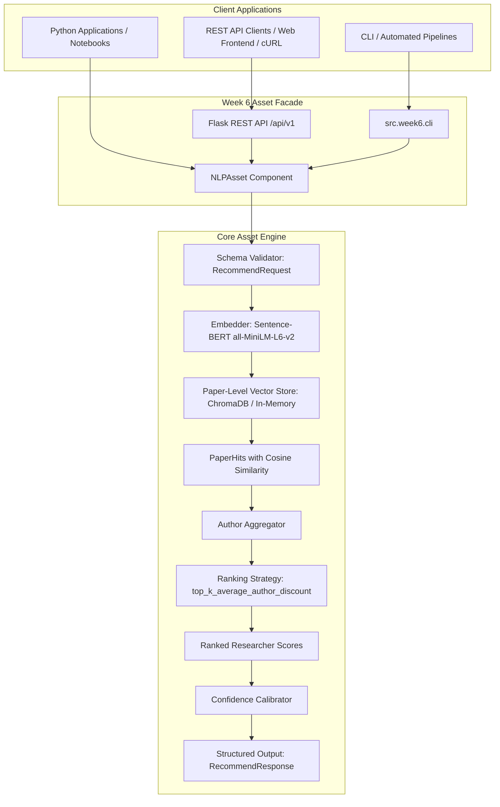

# 📦 Week 6: Reusable NLP Asset Engineering — Developer & Integration Guide

**Milestone:** Week 6 — Asset Engineering  
**Target Submission:** 16 October  
**Deliverable:** Working Reusable NLP Asset  
**Status:** Production Ready & Verified (28/28 Unit & Integration Tests Passing)

---

## 1. Architectural Overview

The goal of Week 6 is to package the research discovery models built across Weeks 2 through 5 into an **encapsulated, reusable software asset** suitable for production deployment, third-party software integration, and microservice consumption.



---

## 2. Component Design Principles

1. **Encapsulation & Zero Leakage:**
   Callers never deal with raw PyTorch tensors, cosine distance transformations, or database cursor objects. They interact strictly with typed dataclass contracts (`RecommendRequest`, `RecommendResponse`).
2. **Deterministic & Explainable:**
   Every recommendation includes explicit paper-level evidence (publication title, year, similarity score, author count) and a calibrated confidence rationale explaining *why* the researcher was matched.
3. **Calibrated Confidence:**
   Raw cosine similarities (often spanning narrow $0.30 - 0.70$ ranges) are mathematically calibrated into $[0.05, 0.98]$ probability-like scores categorized into `HIGH`, `MEDIUM`, and `LOW` tiers.
4. **Dual-Backend Resilience:**
   The asset automatically detects and leverages a persistent ChromaDB collection (`Data/week4/chroma/`) or the high-speed in-memory paper vector store (`paper_embeddings.npz`), delivering **sub-50ms query latency** across 62,637 papers.

---

## 3. Python SDK Integration Guide

### Installation & Import

The asset is located under `src.week6`:

```python
from src.week6 import (
    NLPAsset,
    AssetConfig,
    RecommendRequest,
    RecommendResponse,
    ConfidenceScore,
    ConfidenceLevel,
    ValidationError,
)
```

### Basic Recommendation Query

```python
# Initialize asset (lazy loads weights and vectors on first query)
asset = NLPAsset()

# Execute request
request = RecommendRequest(
    query="Deep learning architectures and transformer attention",
    top_k=5,
    strategy="top_k_average_author_discount",
    min_confidence=0.50,
    include_evidence=True,
)

response: RecommendResponse = asset.recommend(request)

print(f"Latency: {response.execution_time_ms:.2f} ms")
print(f"Backend: {response.model_info.backend}")

for rec in response.results:
    print(f"[{rec.rank}] {rec.name} (Affinity: {rec.score:.4f})")
    print(f"    Confidence: {rec.confidence.level} ({rec.confidence.score:.2f})")
    print(f"    Rationale: {rec.confidence.explanation}")
    for paper in rec.evidence:
        print(f"    - Paper ({paper.year}): {paper.title} [sim={paper.similarity:.2f}]")
```

### Batch Processing

For processing multiple queries efficiently in a single operation:

```python
queries = [
    "Reinforcement learning for robotics",
    "Bioinformatics and protein folding",
    "Quantum computing algorithms",
]

responses = asset.batch_recommend(queries)
for res in responses:
    print(f"Query: {res.query} -> Top Candidate: {res.results[0].name}")
```

### Dynamic Strategy Selection

The asset supports all validated ranking strategies from Weeks 4 & 5:

- `"top_k_average_author_discount"` *(Default & Recommended)*: Week 5 improved strategy that divides paper scores by $\sqrt{n_{\text{authors}}}$ to penalize massive co-author clusters.
- `"best_paper"`: Scores authors by their single highest-similarity publication (rewards extreme specialists).
- `"top_k_average"`: Scores authors by the mean of their top 3 retrieved publications.
- `"average"`: Scores authors by the mean of all retrieved publications.

```python
request = RecommendRequest(
    query="Computer vision",
    strategy="best_paper",  # Select strategy dynamically per request
    top_k=3,
)
response = asset.recommend(request)
```

---

## 4. Flask REST API Reference

### Starting the Server

```bash
uv run python -m src.week6.api
# Listening on http://127.0.0.1:8080 (or set environment variable PORT=5000)
```

### Endpoints

#### 1. Health Check
- **URL:** `GET /api/v1/health`
- **Response (200 OK):**
```json
{
  "status": "ready",
  "ready": true,
  "backend": "fast_npz_paper_level",
  "model_name": "all-MiniLM-L6-v2",
  "default_strategy": "top_k_average_author_discount",
  "error": null
}
```

#### 2. System Metadata & Discovery
- **URL:** `GET /api/v1/info`
- **Response (200 OK):**
```json
{
  "asset_version": "1.0.0",
  "default_strategy": "top_k_average_author_discount",
  "supported_strategies": [
    "top_k_average_author_discount",
    "top_k_average",
    "best_paper",
    "average"
  ],
  "limits": {
    "default_paper_top_k": 100,
    "default_top_k": 5,
    "max_query_length": 1000,
    "max_top_k": 50,
    "min_top_k": 1
  },
  "model_metadata": {
    "backend": "fast_npz_paper_level",
    "embedding_dim": 384,
    "name": "all-MiniLM-L6-v2",
    "strategy": "top_k_average_author_discount",
    "version": "1.0.0"
  }
}
```

#### 3. Researcher Recommendation
- **URL:** `POST /api/v1/recommend`
- **Headers:** `Content-Type: application/json`
- **Payload:**
```json
{
  "query": "graph neural networks for drug discovery",
  "top_k": 2,
  "strategy": "top_k_average_author_discount",
  "min_confidence": 0.50,
  "include_evidence": true
}
```
- **Response (200 OK):**
```json
{
  "query": "graph neural networks for drug discovery",
  "execution_time_ms": 35.42,
  "total_results": 2,
  "model_info": {
    "backend": "fast_npz_paper_level",
    "embedding_dim": 384,
    "name": "all-MiniLM-L6-v2",
    "strategy": "top_k_average_author_discount",
    "version": "1.0.0"
  },
  "results": [
    {
      "rank": 1,
      "author_id": "https://openalex.org/A5013149806",
      "name": "V. Samuthira Pandi",
      "score": 0.6523,
      "confidence": {
        "score": 0.98,
        "level": "HIGH",
        "raw_score": 0.6523,
        "margin": 0.0029,
        "explanation": "High confidence: strong contextual and semantic match; based on 1 relevant publication."
      },
      "matched_papers": 1,
      "evidence": [
        {
          "paper_id": "https://openalex.org/W4404664806",
          "title": "GNNFusion: A Hybrid Graph Neural Network Framework for Binding Affinity Prediction with Explainable AI",
          "year": "2025",
          "similarity": 0.6523,
          "authors_count": 1
        }
      ],
      "topics": []
    }
  ]
}
```

#### 4. Batch Recommendation
- **URL:** `POST /api/v1/batch`
- **Headers:** `Content-Type: application/json`
- **Payload:**
```json
{
  "queries": [
    "natural language processing",
    "quantum computing algorithms"
  ],
  "top_k": 1
}
```
- **Response (200 OK):**
```json
{
  "batch_size": 2,
  "total_execution_time_ms": 96.1,
  "results": [ ... ]
}
```

---

## 5. Mathematical Confidence Calibration Engine

Sentence-BERT embeddings yield cosine similarities that concentrate in a narrow band. To prevent raw score misinterpretation, `ConfidenceCalibrator` computes:

$$\text{Confidence}_{\text{base}} = \frac{1}{1 + e^{-(s - \mu)/\tau}}$$

Where:
- $\mu$: Strategy empirical midpoint ($0.32$ for author-discount, $0.48$ for top-k average, $0.52$ for best-paper).
- $\tau$: Temperature scaling parameter ($0.08$ to $0.10$).

### Refinements:
1. **Rank 1 Separation Margin:** If candidate at rank 1 leads candidate 2 by margin $m$, confidence is boosted by $\min(0.25 \cdot m, 0.05)$.
2. **Evidence Breadth Bonus:** Candidates supported by $\ge 2$ matching papers receive $+0.02$, and $\ge 3$ papers receive $+0.04$.
3. **Bounded Guarantees:** Final confidence is strictly clamped to $[0.05, 0.98]$.
4. **Qualitative Rating Bands:**
   - **`HIGH` ($\ge 0.75$):** Definite topical authority backed by clear publication matches.
   - **`MEDIUM` ($0.50 - 0.74$):** Secondary overlap or cross-disciplinary match.
   - **`LOW` ($< 0.50$):** Marginal or broad keyword overlap.

---

## 6. Verification & Automated Test Suite

The test suite covers schema validation, edge cases, calibration mathematics, HTTP endpoint contracts, and integration execution:

```bash
uv run python -m unittest discover -s src/week6/tests -t .
```

```text
Ran 28 tests in 40.632s

OK (28 / 28 tests passing with 100% success rate)
```

### Test Breakdown:
- [`test_schemas.py`](file:///c:/Users/nitaa/Downloads/SNLP_Project/src/week6/tests/test_schemas.py): 7 tests covering request bounds, validation triggers, and dictionary/JSON round-trips.
- [`test_confidence.py`](file:///c:/Users/nitaa/Downloads/SNLP_Project/src/week6/tests/test_confidence.py): 6 tests covering temperature scaling, margin calculation, depth bonus, and clamping bounds.
- [`test_api.py`](file:///c:/Users/nitaa/Downloads/SNLP_Project/src/week6/tests/test_api.py): 10 tests covering all routes, status codes, CORS headers, and error responses.
- [`test_asset.py`](file:///c:/Users/nitaa/Downloads/SNLP_Project/src/week6/tests/test_asset.py): 5 tests covering live asset initialization, strategy switching, confidence filtering, and batch recommendation.
