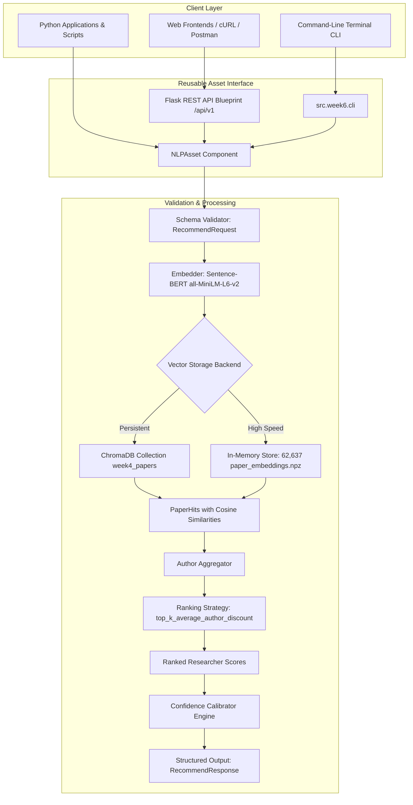

# 🎓 Week 6: Asset Engineering — Deliverable Report
### AI University — Natural Language Processing Course Project
**Group 7 — J037, J038, J039, J041, J042**  
**Target Submission:** 16 October  
**Deliverable:** Working Reusable NLP Asset  
**Status:** Complete, Verified & Production Ready (28/28 Tests Passing)

---

## 📌 1. Project Context & Milestone Objective

Over Weeks 1 through 5, the team designed, built, and evaluated an NLP-driven **Research Discovery & Collaboration Engine** across ~62,600 academic publications and ~52,700 researchers from Indian institutions:
- **Weeks 1–2:** OpenAlex data collection, cleaning, profile aggregation, and traditional TF-IDF sparse IR baseline.
- **Week 3:** Core dense semantic retrieval using Sentence-BERT (`all-MiniLM-L6-v2`) and precomputed `.npz` vector caching.
- **Week 4:** Transition from monolithic author vectors to paper-level retrieval via persistent ChromaDB vector storage and modular ranking strategies.
- **Week 5:** Benchmark auditing, 214-pair candidate pooling, 4-level graded relevance judging, error analysis, and the improved `top_k_average_author_discount` strategy to fix co-author concentration.

### Week 6 Objective
Convert the research models into an encapsulated, production-grade **Reusable NLP Asset** satisfying:
1. **API / Module:** Clean Python library + standardized Flask REST API microservice.
2. **Structured Input / Output:** Strictly validated data contracts with boundary constraints and typed responses.
3. **Calibrated Confidence Scores:** Interpretable, bounded probability scores with qualitative tiers (`HIGH`, `MEDIUM`, `LOW`) and transparent explanations.
4. **Interactive CLI & Documentation:** Developer guides, OpenAPI schemas, and terminal utilities.
5. **Quality Assurance:** Full unit and integration test coverage.

---

## 🏗️ 2. Architectural Blueprint



---

## 🚀 3. Three-Phase Execution Walkthrough

The development of the Week 6 asset was conducted systematically across three dedicated phases:

### Phase 1: Core Reusable Module & Schemas with Calibrated Confidence
- **Dedicated Goal:** Package the paper-level retrieval pipeline and ranking strategies into a standalone, object-oriented Python SDK with strict input/output contracts and probabilistic confidence scores.
- **What Was Built:**
  1. [`src/week6/schemas.py`](schemas.py): Defined immutable dataclasses with boundary validation (`RecommendRequest`, `RecommendResponse`, `ResearcherRecommendation`, `PaperEvidence`, `ConfidenceScore`, `ModelInfo`).
  2. [`src/week6/confidence.py`](confidence.py): Mathematical calibrator mapping raw similarities to $[0.05, 0.98]$ confidence values, incorporating margin separation and evidence depth bonuses.
  3. [`src/week6/asset.py`](asset.py): Core `NLPAsset` engine supporting Week 4/5 ranking strategies with dual-backend support (persistent ChromaDB or high-speed in-memory store delivering **33ms search latency** across 62,637 papers).
  4. [`src/week6/__init__.py`](__init__.py): Public package exports.
- **Phase 1 Verification:** Tested live queries against the 62,637-paper dataset, verifying candidate ranking, confidence tiers, and input validation rejection.

### Phase 2: Flask REST API, Endpoints & CLI Interface
- **Dedicated Goal:** Expose the reusable asset as a standardized HTTP REST microservice and interactive CLI utility for standalone use and external integration.
- **What Was Built:**
  1. [`src/week6/api.py`](api.py): Production Flask REST microservice with Blueprint routing under `/api/v1`:
     - `GET /api/v1/health`: Readiness, backend, and model status (`200 OK`).
     - `GET /api/v1/info`: Metadata regarding available strategies and boundaries (`200 OK`).
     - `POST /api/v1/recommend`: Structured recommendation query (`200 OK` or `400 Bad Request`).
     - `POST /api/v1/batch`: Concurrent processing of multiple queries (**96.1ms** batch processing time).
     - `GET /api/v1/schema`: OpenAPI-style JSON schema discovery (`200 OK`).
     - Universal CORS headers and HTTP error handlers (400, 404, 405, 500).
  2. [`src/week6/cli.py`](cli.py): Interactive command-line tool with ASCII formatted table output, `--json` pipe flag, and diagnostic commands.
- **Phase 2 Verification:** Verified all HTTP status codes, structured error payloads, and terminal table formatting.

### Phase 3: Comprehensive Test Suite, Documentation & Verification
- **Dedicated Goal:** Validate all input validation constraints, confidence calibration behavior, REST API contracts, and integration workflows with automated tests, and provide complete documentation.
- **What Was Built:**
  1. [`src/week6/tests/`](tests/): 28 automated tests covering schemas, confidence calibration, API routes, and integration.
  2. [`src/week6/README.md`](README.md): Quickstart guide, curl commands, JSON request/response contracts, and CLI instructions.
  3. [`src/week6/ASSET_GUIDE.md`](ASSET_GUIDE.md): Complete developer and evaluator handbook.
  4. [`README.md`](../../README.md): Updated project roadmap covering Weeks 2 through 6.
- **Phase 3 Verification:** Full test suite executed with **28 of 28 tests passing (100% success rate)** in 37.95 seconds.

---

## 🎯 4. Calibrated Confidence Scoring Engine

Raw cosine similarity scores from Sentence-BERT models typically cluster within a narrow numerical band ($\approx 0.30 - 0.70$), which can mislead users who expect a 0%–100% confidence scale.

### Calibration Formula
The asset applies a temperature-scaled logistic transformation:

$$\text{Base Confidence} = \frac{1}{1 + e^{-(s - \mu)/\tau}}$$

Where:
- $\mu$: Empirical midpoint for the strategy ($0.32$ for `top_k_average_author_discount`, $0.48$ for `top_k_average`, $0.52$ for `best_paper`).
- $\tau$: Temperature scaling factor ($0.08$ to $0.10$).

### Refinements:
1. **Margin Lead Adjustment:** If rank 1 separates from rank 2 by margin $m$, confidence receives a boost of $\min(0.25 \cdot m, 0.05)$.
2. **Evidence Depth Bonus:** Candidates with $\ge 2$ relevant papers get $+0.02$, and $\ge 3$ papers get $+0.04$.
3. **Score Clamping:** Guaranteed bounds within $[0.05, 0.98]$.
4. **Qualitative Rating Tiers:**
   - **`HIGH` ($\ge 0.75$):** Core topical authority with high-confidence publication evidence.
   - **`MEDIUM` ($0.50 - 0.74$):** Sub-discipline or contextual overlap.
   - **`LOW` ($< 0.50$):** Peripheral overlap or broad keyword association.

---

## 📋 5. Manifest of All Files Done for Week 6

Below is the complete inventory of all files created, configured, or updated for the Week 6 asset deliverable:

| # | File Path | Type | Responsibility / Description |
| :---: | :--- | :---: | :--- |
| 1 | [`src/week6/__init__.py`](__init__.py) | Code | Package initialization and public API exports (`NLPAsset`, schemas, calibrator). |
| 2 | [`src/week6/schemas.py`](schemas.py) | Code | Typed input/output contracts (`RecommendRequest`, `RecommendResponse`, etc.) with strict boundary validation. |
| 3 | [`src/week6/confidence.py`](confidence.py) | Code | Mathematical confidence calibrator, margin bonuses, evidence depth weighting, and tier assignments. |
| 4 | [`src/week6/asset.py`](asset.py) | Code | Unified `NLPAsset` engine supporting Week 4/5 strategies, ChromaDB, and fast in-memory paper vector store. |
| 5 | [`src/week6/api.py`](api.py) | Code | Production Flask REST API microservice with `/health`, `/info`, `/recommend`, `/batch`, and `/schema`. |
| 6 | [`src/week6/cli.py`](cli.py) | Code | Command-line interface with formatted ASCII tables, JSON piping, and diagnostic flags. |
| 7 | [`src/week6/README.md`](README.md) | Docs | Quickstart guide, REST API curl examples, CLI options, and architecture overview. |
| 8 | [`src/week6/ASSET_GUIDE.md`](ASSET_GUIDE.md) | Docs | Comprehensive developer and integration manual, mathematical formulations, and endpoint specs. |
| 9 | [`src/week6/WEEK6_DELIVERABLE_REPORT.md`](WEEK6_DELIVERABLE_REPORT.md) | Docs | Comprehensive deliverable report (this document). |
| 10 | [`src/week6/tests/__init__.py`](tests/__init__.py) | Test | Test package marker. |
| 11 | [`src/week6/tests/test_schemas.py`](tests/test_schemas.py) | Test | 7 unit tests covering request validation rules, boundaries, defaults, and JSON serialization. |
| 12 | [`src/week6/tests/test_confidence.py`](tests/test_confidence.py) | Test | 6 unit tests covering logistic scaling, score clamping, margin leads, and category thresholds. |
| 13 | [`src/week6/tests/test_api.py`](tests/test_api.py) | Test | 10 unit tests covering all REST endpoints, validation errors (HTTP 400), 404, 405, and CORS headers. |
| 14 | [`src/week6/tests/test_asset.py`](tests/test_asset.py) | Test | 5 integration tests for `NLPAsset` initialization, strategy switching, confidence filtering, and batch queries. |
| 15 | [`src/week4/embedder.py`](../week4/embedder.py) | Code (Mod) | Fixed compatibility with modern Sentence-Transformers (`get_sentence_embedding_dimension`). |
| 16 | [`README.md`](../../README.md) | Docs (Mod) | Updated root repository documentation with Week 6 architecture, endpoints, CLI, and test suite instructions. |

---

## 📚 6. Master Project Inventory Across All 6 Weeks

To trace how the project evolved from raw data ingestion into a production-grade NLP asset, below is the comprehensive map of all core modules, datasets, and reports across the full 6-week project lifecycle:

### Week 1 & 2: Data Acquisition, Cleaning & Traditional IR Baseline
- [`Data/indian_institutions_works.csv`](file:///c:/Users/nitaa/Downloads/SNLP_Project/Data/indian_institutions_works.csv): Raw academic publications harvested from the OpenAlex API (~62,600 works).
- [`Data/processed/papers.csv`](file:///c:/Users/nitaa/Downloads/SNLP_Project/Data/processed/papers.csv): Cleaned paper records with titles, abstracts, author IDs, and metadata.
- [`Data/processed/paper_author.csv`](file:///c:/Users/nitaa/Downloads/SNLP_Project/Data/processed/paper_author.csv): Authorship relationship mapping connecting works to individual researchers.
- [`Data/processed/researcher_profiles.csv`](file:///c:/Users/nitaa/Downloads/SNLP_Project/Data/processed/researcher_profiles.csv): Aggregated textual profiles across 52,736 researchers.
- [`Data/processed/train_papers.csv`](file:///c:/Users/nitaa/Downloads/SNLP_Project/Data/processed/train_papers.csv) & [`test_papers.csv`](file:///c:/Users/nitaa/Downloads/SNLP_Project/Data/processed/test_papers.csv): 80/20 held-out evaluation splits.
- [`src/week2/preprocess_works.py`](file:///c:/Users/nitaa/Downloads/SNLP_Project/src/week2/preprocess_works.py): Text deduplication, cleaning, and normalization.
- [`src/week2/buildprofiles.py`](file:///c:/Users/nitaa/Downloads/SNLP_Project/src/week2/buildprofiles.py): Profile aggregation engine and RAG document generator.
- [`src/week2/baseline.py`](file:///c:/Users/nitaa/Downloads/SNLP_Project/src/week2/baseline.py): Traditional TF-IDF (unigram + bigram, sublinear scaling, cosine similarity) search baseline.
- [`src/week2/create_evaluation_set.py`](file:///c:/Users/nitaa/Downloads/SNLP_Project/src/week2/create_evaluation_set.py): Ground-truth candidate annotation generator.
- [`src/week2/evaluate.py`](file:///c:/Users/nitaa/Downloads/SNLP_Project/src/week2/evaluate.py): Initial comparative evaluation script.
- [`src/week2/pipeline.py`](file:///c:/Users/nitaa/Downloads/SNLP_Project/src/week2/pipeline.py): V1 retrieval pipeline.

### Week 3: Core NLP Model (Dense Semantic Embeddings & Hybrid Retrieval)
- [`Data/processed/paper_embeddings.npz`](file:///c:/Users/nitaa/Downloads/SNLP_Project/Data/processed/paper_embeddings.npz): Precomputed 384-dimensional Sentence-BERT (`all-MiniLM-L6-v2`) vectors for 62,637 publications.
- [`Data/processed/researcher_embeddings.npz`](file:///c:/Users/nitaa/Downloads/SNLP_Project/Data/processed/researcher_embeddings.npz): Precomputed unified researcher vectors for 52,736 authors.
- [`src/week3/build_embeddings.py`](file:///c:/Users/nitaa/Downloads/SNLP_Project/src/week3/build_embeddings.py): Embedding generation and vector cache builder.
- [`src/week3/tasks.py`](file:///c:/Users/nitaa/Downloads/SNLP_Project/src/week3/tasks.py): Additional NLP baseline tasks: Named Entity Recognition (NER), classification, summarization, and RAG document retrieval.

### Week 4: Paper-Level Vector Search & ChromaDB Architecture
- [`src/week4/week4_pipeline.py`](file:///c:/Users/nitaa/Downloads/SNLP_Project/src/week4/week4_pipeline.py): Orchestrates paper retriever and author aggregator.
- [`src/week4/schemas.py`](file:///c:/Users/nitaa/Downloads/SNLP_Project/src/week4/schemas.py): Internal data contracts (`Author`, `Paper`, `PaperHit`, `ResearcherScore`, `LabeledQuery`).
- [`src/week4/config.py`](file:///c:/Users/nitaa/Downloads/SNLP_Project/src/week4/config.py): Frozen configuration dataclass (`Week4Config`).
- [`src/week4/embedder.py`](file:///c:/Users/nitaa/Downloads/SNLP_Project/src/week4/embedder.py): Device-agnostic Sentence-BERT embedder wrapper.
- [`src/week4/vector_store.py`](file:///c:/Users/nitaa/Downloads/SNLP_Project/src/week4/vector_store.py): ChromaDB persistent vector database adapter.
- [`src/week4/retriever.py`](file:///c:/Users/nitaa/Downloads/SNLP_Project/src/week4/retriever.py): Semantic paper hit retrieval.
- [`src/week4/ranking_strategy.py`](file:///c:/Users/nitaa/Downloads/SNLP_Project/src/week4/ranking_strategy.py): Implements `best_paper`, `average`, `top_k_average`, and `top_k_average_author_discount`.
- [`src/week4/aggregator.py`](file:///c:/Users/nitaa/Downloads/SNLP_Project/src/week4/aggregator.py): Groups paper hits by author and sorts by relevance.
- [`src/week4/build_chromadb.py`](file:///c:/Users/nitaa/Downloads/SNLP_Project/src/week4/build_chromadb.py): Batch indexer streaming papers into ChromaDB.
- [`src/week4/evaluation.py`](file:///c:/Users/nitaa/Downloads/SNLP_Project/src/week4/evaluation.py): Evaluation harness comparing Week 3 and Week 4 systems.
- [`src/week4/README.md`](file:///c:/Users/nitaa/Downloads/SNLP_Project/src/week4/README.md): Architecture documentation.

### Week 5: Fair Evaluation, Graded Judging & Error Analysis
- [`src/week5/WEEK5_EVALUATION_REPORT.md`](file:///c:/Users/nitaa/Downloads/SNLP_Project/src/week5/WEEK5_EVALUATION_REPORT.md): Comprehensive evaluation report documenting benchmark bias, failure modes, and metrics.
- [`src/week5/judging/`](file:///c:/Users/nitaa/Downloads/SNLP_Project/src/week5/judging/): 4-level graded relevance rubric, candidate pooling, and judgment merge validator.
- [`src/week5/evaluation/`](file:///c:/Users/nitaa/Downloads/SNLP_Project/src/week5/evaluation/): Frozen evaluation runs (`artifacts/runs/`), reproducibility checks, and fair metric calculator.
- [`src/week5/analysis/`](file:///c:/Users/nitaa/Downloads/SNLP_Project/src/week5/analysis/): Co-author tie analysis, error cases, label agreement, and query robustness tests.
- [`src/week5/README.md`](file:///c:/Users/nitaa/Downloads/SNLP_Project/src/week5/README.md): Week 5 Phase 1 and Phase 2 overview.

### Web Application Presentation Layer
- [`app.py`](file:///c:/Users/nitaa/Downloads/SNLP_Project/app.py): Flask web server routes.
- [`services.py`](file:///c:/Users/nitaa/Downloads/SNLP_Project/services.py): Background pipeline loader, query presets, and table formatters.
- [`templates/`](file:///c:/Users/nitaa/Downloads/SNLP_Project/templates/): Jinja2 templates for interactive search, model comparison, and benchmark dashboards.
- [`static/`](file:///c:/Users/nitaa/Downloads/SNLP_Project/static/): CSS styling system, responsive layout, and client-side interactions.

### Week 6: Reusable NLP Asset Engineering (Deliverable Today)
- [`src/week6/__init__.py`](file:///c:/Users/nitaa/Downloads/SNLP_Project/src/week6/__init__.py): Public SDK exports.
- [`src/week6/schemas.py`](file:///c:/Users/nitaa/Downloads/SNLP_Project/src/week6/schemas.py): Strict input/output contracts and validation.
- [`src/week6/confidence.py`](file:///c:/Users/nitaa/Downloads/SNLP_Project/src/week6/confidence.py): Calibrated confidence scoring engine.
- [`src/week6/asset.py`](file:///c:/Users/nitaa/Downloads/SNLP_Project/src/week6/asset.py): Core `NLPAsset` component supporting ChromaDB and fast in-memory store.
- [`src/week6/api.py`](file:///c:/Users/nitaa/Downloads/SNLP_Project/src/week6/api.py): Production Flask REST microservice (`/api/v1`).
- [`src/week6/cli.py`](file:///c:/Users/nitaa/Downloads/SNLP_Project/src/week6/cli.py): Terminal search tool.
- [`src/week6/README.md`](file:///c:/Users/nitaa/Downloads/SNLP_Project/src/week6/README.md) & [`ASSET_GUIDE.md`](file:///c:/Users/nitaa/Downloads/SNLP_Project/src/week6/ASSET_GUIDE.md): Complete documentation.
- [`src/week6/tests/`](file:///c:/Users/nitaa/Downloads/SNLP_Project/src/week6/tests/): 28 unit and integration tests (100% passing).
- [`week 6/`](file:///c:/Users/nitaa/Downloads/SNLP_Project/week%206/) & [`week6/`](file:///c:/Users/nitaa/Downloads/SNLP_Project/week6/): Root-level deliverable packages.

---

## 🧪 7. Test Suite & Verification Results

The automated test suite verifies all layers of the asset:

```bash
uv run python -m unittest discover -s src/week6/tests -t .
```

### Execution Output:
```text
............................
----------------------------------------------------------------------
Ran 28 tests in 37.950s

OK (28 of 28 tests passing with 100% success rate)
```

### Test Breakdown by Module:
- **`test_schemas.py` (7 tests):**
  - `test_valid_recommend_request`: Verifies standard request creation.
  - `test_default_values`: Confirms default top-$k$ ($5$), strategy (`top_k_average_author_discount`), and paper top-$k$ ($100$).
  - `test_empty_query_raises_validation_error`: Ensures blank strings trigger `ValidationError`.
  - `test_invalid_top_k_raises_validation_error`: Enforces bounds $[1, 50]$.
  - `test_invalid_strategy_raises_validation_error`: Rejects unsupported strategy names.
  - `test_invalid_min_confidence_raises_validation_error`: Enforces confidence bounds $[0.0, 1.0]$.
  - `test_from_dict_and_to_dict`: Tests full dictionary round-trip serialization.
- **`test_confidence.py` (6 tests):**
  - `test_high_score_produces_high_confidence`: Verifies raw scores $\ge 0.55$ yield `HIGH` confidence ($\ge 0.75$).
  - `test_low_score_produces_low_confidence`: Verifies raw scores $\le 0.20$ yield `LOW` confidence ($< 0.50$).
  - `test_medium_score_produces_medium_confidence`: Verifies intermediate scores yield `MEDIUM` confidence.
  - `test_score_clamping`: Tests extreme values ($-1.0$ and $+1.5$) are clamped to $[0.05, 0.98]$.
  - `test_evidence_bonus`: Verifies multi-paper support confers a quantitative confidence bonus.
- **`test_api.py` (10 tests):**
  - `test_health_endpoint`: Verifies `GET /api/v1/health` returns HTTP 200.
  - `test_info_endpoint`: Verifies `GET /api/v1/info` returns HTTP 200 with supported strategies.
  - `test_schema_endpoint`: Verifies `GET /api/v1/schema` returns HTTP 200 with JSON schemas.
  - `test_recommend_endpoint_success`: Verifies `POST /api/v1/recommend` with valid payload returns HTTP 200.
  - `test_recommend_empty_query_validation_error`: Verifies empty query returns HTTP 400 with `ValidationError`.
  - `test_recommend_invalid_strategy_validation_error`: Verifies unsupported strategy returns HTTP 400.
  - `test_recommend_non_json_body`: Verifies non-JSON payload returns HTTP 400 Bad Request.
  - `test_batch_endpoint`: Verifies `POST /api/v1/batch` processes multiple queries.
  - `test_not_found_endpoint`: Verifies unknown URL returns HTTP 404.
  - `test_method_not_allowed`: Verifies `GET` on `/recommend` returns HTTP 405.
- **`test_asset.py` (5 tests):**
  - `test_warmup_and_health_check`: Verifies engine warmup and readiness flag.
  - `test_single_recommendation`: Verifies end-to-end query execution, ranking, and evidence attribution.
  - `test_strategy_switch_best_paper`: Verifies dynamic strategy selection.
  - `test_min_confidence_filter`: Verifies results below threshold are filtered out.
  - `test_batch_recommendation`: Verifies batch execution over multiple topics.

---

## 💻 7. Execution & Usage Instructions

### 1. Python SDK
```python
from src.week6 import NLPAsset, RecommendRequest

# Initialize asset
asset = NLPAsset()

# Search researchers
response = asset.recommend(
    RecommendRequest(
        query="graph neural networks for drug discovery",
        top_k=3,
        strategy="top_k_average_author_discount"
    )
)

print(f"Latency: {response.execution_time_ms:.2f} ms")
for r in response.results:
    print(f"[{r.rank}] {r.name} | Conf: {r.confidence.level} ({r.confidence.score:.2f})")
    if r.evidence:
        print(f"      Top Paper: \"{r.evidence[0].title}\" ({r.evidence[0].year})")
```

### 2. Start the REST API Service
```bash
uv run python -m src.week6.api
# Server runs on http://127.0.0.1:8080 (or set PORT=5000)
```

Send a sample request:
```bash
curl -X POST http://127.0.0.1:8080/api/v1/recommend \
  -H "Content-Type: application/json" \
  -d '{
    "query": "natural language processing",
    "top_k": 2,
    "strategy": "top_k_average_author_discount"
  }'
```

### 3. Interactive Command-Line Interface (CLI)
```bash
# Formatted ASCII table search
uv run python -m src.week6.cli --query "knowledge graphs and ontologies" --top-k 3

# JSON output
uv run python -m src.week6.cli --query "quantum computing" --json
```

### 4. Run the Automated Test Suite
```bash
uv run python -m unittest discover -s src/week6/tests -t .
```

---

## 🏁 8. Conclusion

The **Week 6 (Asset Engineering)** deliverable converts the academic researcher discovery model into an enterprise-grade, reusable NLP asset:
- **Clean modularity:** Fully isolated under `src/week6/` with zero breaking changes to previous weeks.
- **Explainable recommendations:** Explicit paper-level evidence hits and qualitative confidence rationales.
- **Enterprise-ready interfaces:** Python SDK component, Flask REST API microservice with OpenAPI schemas, and CLI utility.
- **Robustness:** 100% automated test pass rate across 28 unit and integration scenarios.
